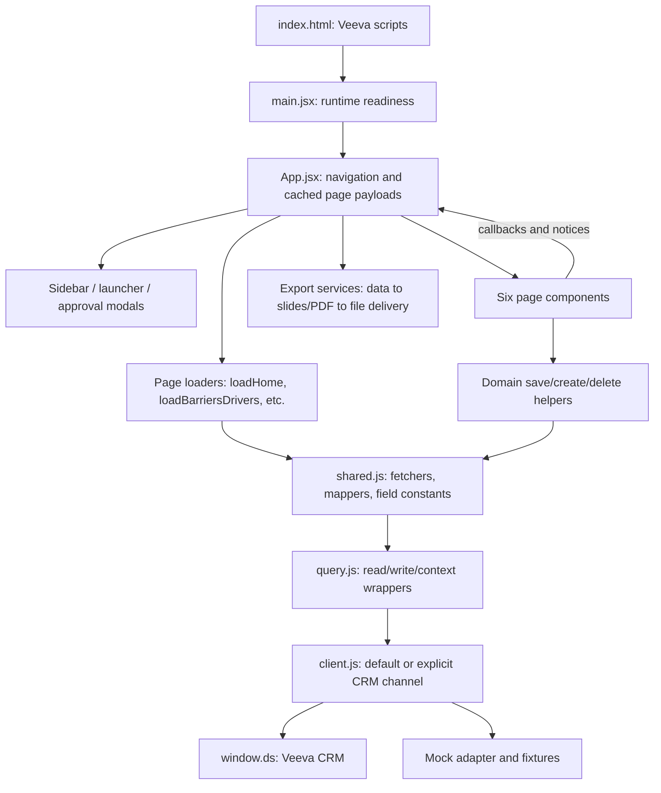
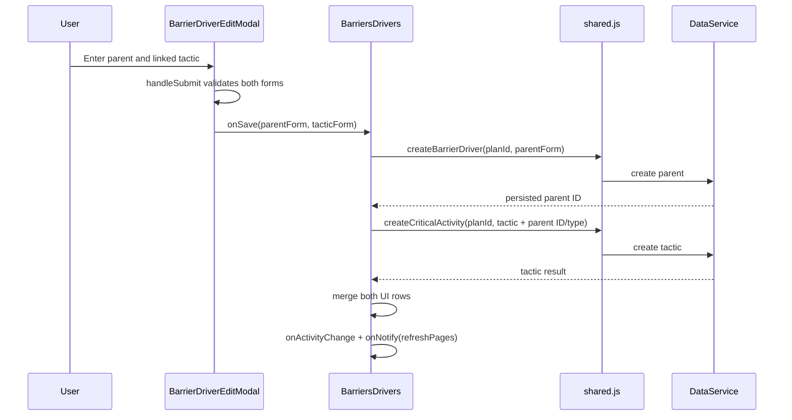

# Medical Account Plan: page-by-page code walkthrough

Prepared for the 28 October 2026 team handoff from the working tree inspected on 27 October 2026. This explains the current local source, including existing uncommitted changes. It does not establish what is deployed in CRM.

Read this guide first. Use [the function catalog](FUNCTION_CATALOG.md) when someone asks about a specific function: it gives each named application function a source link, explanation, and its connections. The existing [KT SOP](Kite_MyInsights_KT_SOP_Medicalv2.md) covers operating procedures; this guide focuses on understanding the code.

## 1. The explanation to start your presentation with

> This is a React application embedded in Veeva CRM through MyInsights. It helps a medical team maintain an account plan: identify Barriers and Opportunities, attach Medical Tactics, maintain Medical profiles and team membership, review stakeholders, and submit the plan for approval. React supplies the screens. Veeva's DataService supplies the CRM connection. App.jsx coordinates the screens, and the accountPlan services translate between CRM records and the data the screens display.

There is no application-owned server in this repository. React calls the Veeva bridge rather than a custom REST backend. Salesforce objects, validation rules, sharing, and automation are external dependencies.

Two vocabulary translations explain many filenames:

| User-facing term | Internal term | Reason it matters |
| --- | --- | --- |
| Home | Overview | `pages/Overview` is the Home page. |
| Opportunities | Drivers / `Driver` | Keep the stored type and record-type mappings; changing labels alone does not change schema. |
| Medical Tactics | Critical Activities | `pages/CriticalActivities` and `criticalActivities.js` own tactics. |
| Medical Account Profile | `kpi` page key | `App.jsx` caches this page under `pageData.kpi`. |
| Submit FD approval | MPD/MRD names in handlers | Follow `submitMpdApproval` and profile constants to understand actual routing. |
| Ecosystem Plan | Account Profile record | Medical and Commercial profile fields live on `KPH_Ecosystem_Plan__c`. |

## 2. A few React terms you need

- **Component:** a function returning JSX, the HTML-like description of a screen. `<TeamMembers />` calls the component function and lets React render it.
- **Props:** inputs passed from a parent, such as `data` and `onNotify`.
- **State / `useState`:** local values whose changes redraw the screen, such as the current tab or draft form.
- **Effect / `useEffect`:** code run after rendering to load data, attach listeners, or synchronize state. Its cleanup removes listeners/timers.
- **`useMemo`:** calculates a derived value again only when its dependencies change. It does not persist to CRM.
- **`useCallback`:** retains a function reference until dependencies change. It does not call that function by itself.
- **Ref / `useRef`:** mutable storage that survives renders without causing a redraw, used for request trackers, DOM elements, and prepared export files.
- **Callback:** a function passed to a child. `onActivityChange(updated)` lets a child tell `App` that a tactic changed.
- **Promise / `async` / `await`:** represents work that finishes later. `Promise.all` runs independent reads together and waits for all of them; one rejection rejects the combined operation.

## 3. Folder map and architecture

| Location | Responsibility |
| --- | --- |
| `index.html` | Loads the Veeva scripts and the React entry module. |
| `src/main.jsx` | Waits for the runtime bridge, then mounts React. |
| `src/App.jsx` | Chooses the page, loads/caches its data, coordinates approval and export actions. |
| `src/pages` | The six page families and their forms/subsections. |
| `src/components` | Shared sidebar, launcher, modals, loaders, help, PDF viewer, and sorting controls. |
| `src/lib/dataservice/client.js` | Chooses mock/default adapters and exposes explicit live CRM channels. |
| `src/lib/dataservice/query.js` | Wraps Veeva primitives, normalizes responses, and handles Salesforce IDs. |
| `src/lib/dataservice/accountPlan/*.js` | Page loaders and domain logic. |
| `src/lib/dataservice/accountPlan/shared.js` | Object/field constants, fetchers, record mappers, and write helpers used by multiple pages. |
| `src/lib/helper` | Display formatting, filtering, sorting, modal behavior, duplicate-user handling. |
| `src/lib/export` | Export data assembly, slide/PDF layout, file creation and delivery. |
| `src/lib/mockData` | CRM-shaped fixtures, mock DataService, local persistence. |
| `src/styles`, page CSS | Shared and page-specific appearance. |
| `public/static` | Bundled Q and Veeva MyInsights runtime libraries; vendor integration boundary. |
| `test`, `src/lib/export/*.test.js` | Tests of business rules, source wiring, exports, and regressions. |
| `scripts`, `vite.config.js` | Build packaging and documentation/data tooling. |



The central pattern repeats on every page:

```text
App selects a page
  → load<Page>() resolves the Account Plan ID
  → shared fetchers query CRM-shaped records
  → mappers turn CRM field names into simple properties
  → loader returns one page payload
  → App caches it and passes it as data
  → page renders tables and forms
  → save handler calls a shared writer
  → local state/callbacks update immediately
  → a success notice requests a background reload of cached pages
```

## 4. Startup and navigation: explain these before the pages

Open [main.jsx](../src/main.jsx), [App.jsx](../src/App.jsx), and [viewMode.js](../src/lib/runtime/viewMode.js).

`main.jsx` first collects runtime diagnostics. `waitForVeevaDataService` gives packaged Veeva scripts a chance to initialize; in some iPad containers it replays the packaged scripts sequentially. It then dynamically imports `App` and mounts it inside React `StrictMode`. The bridge adapter now accesses `window.ds` dynamically, even though an older comment in `main.jsx` describes snapshotting it.

`detectRuntimeViewMode` uses device signals, viewport width, and hosting protocol. A narrow desktop browser and a real iPad are not equivalent. The distinction controls whether the app needs an Account Plan launcher.

Local preview is intended to enter the seeded plan directly. Packaged desktop opens `AccountPlanLauncher`; selecting a row calls `handleSelectLauncherPlan`, sets a plan ID override, clears the old workspace, and loads Home. iPad normally obtains the plan from Veeva record context.

There is no React Router. `PAGES` is the navigation registry, and `activeKey` chooses which component is rendered. Navigation is React state, not a separate URL per page.

| Page key | Label | Loader |
| --- | --- | --- |
| `overview` | Home | `loadHome` |
| `barriers-drivers` | Barriers & Opportunities | `loadBarriersDrivers` |
| `critical-activities` | Medical Tactics | `loadCriticalActivities` |
| `kpi` | Medical Account Profile | `loadAccountProfile` |
| `stakeholders` | Stakeholders | `loadStakeholders` |
| `team-members` | Team Members | `loadTeamMembers` |

### The important App functions

| Function or group | What it does and why |
| --- | --- |
| `loadPage` | Looks up the loader; reuses an in-flight request; updates loading/error/ready state; stores the payload. `force` refreshes an already-loaded page. Background refresh failures keep the previous successful payload. |
| `updateCachedPageData` | Applies a child's changes to one cached page payload. |
| `syncCriticalActivityAcrossCaches` | Updates or removes the same tactic in Home, Barriers/Opportunities, and Medical Tactics caches. |
| `syncTeamMemberAcrossCaches`, `removeTeamMemberAcrossCaches` | Keep Home and Team Members consistent after membership edits/deletion. |
| `navigateToPage` | Changes `activeKey` and clears a pending tactic edit target. |
| `navigateToBarriersDrivers` | Opens the correct Barrier or Opportunity tab from Home. |
| `navigateToCriticalActivity` | Records which tactic to open; an effect coordinates loading/navigation before the edit request is consumed. |
| `resetAccountPlanWorkspace` | Clears page/request/export state before selecting another plan. |
| `showAppNotice` | Displays a temporary success/error message; `refreshPages: true` triggers background refresh. |
| `refreshApprovalStatus` | Fetches a small plan status snapshot; coalesces requests and throttles repeated checks. |
| `refreshLoadedPages` | Refreshes pages already loaded, including after a save or app resume. |
| `resolveShellSource` | Keeps account/plan sidebar information available from cached payloads while another page loads. |

Effects preload Stakeholders and Team Members at startup and the remaining pages after Home becomes ready. Approval status is checked on a three-second interval, with throttling, and refreshed when the app regains focus. Resume also refreshes cached page data. Export preparation is scheduled after page data changes.

The Sidebar receives navigation and action callbacks from App. Its pointer handlers distinguish a tap from a drag and prevent pointer-plus-click duplicate navigation. It preloads a page on pointer down. Help opens bundled PDF documents through `PdfAllPagesViewer`.

## 5. Data model: the records behind the screens

| CRM object | Purpose and connection |
| --- | --- |
| `Account_Plan_vod__c` | Root plan. Its `Account_vod__c` links to the Account; it also holds Medical approval/routing fields. |
| `Account` | Account name, EID, territory, MM ATC Priority, referral-site and stakeholder identity data. |
| `KPH_Ecosystem_Plan__c` | Profile/context record linked to the plan through `KPH_Account_Plan__c`; holds Medical/Commercial profile fields and regional dynamics. |
| `KPH_Medical_Barrier_Tactical_Actions__c` | Parent Barrier or Opportunity. Linked to plan by `KPH_Account_Plan__c`; type is determined using Medical record types. |
| `KPH_Medical_Tactics__c` | Tactic. `KPH_Account_Plans__c` links to plan, `KPH_Barrier_or_Opportunity__c` links to parent Barrier/Opportunity. |
| `Account_Team_Member_vod__c` | Plan membership via `Account_Plan_vod__c`; `Team_Member_vod__c` identifies the User. |
| `KPH_Stakeholder_Map__c` | Plan stakeholder link; `KPH_Account__c` identifies the stakeholder Account. |
| `KPH_Ecosystem_Map_Dynamics__c` | Referral mapping linked to plan/profile; `KPH_Name_of_Site__c` identifies a site Account. |
| `KPH_Other_Healthcare_Networks__c` | Healthcare network rows associated with the profile. |
| `KPH_Account_Plan_Approval_History__c` | Approval history displayed by the app. |
| `User`, `RecordType` | Identity, manager routing, user lookup, and metadata describing permitted record types. |

See [shared.js](../src/lib/dataservice/accountPlan/shared.js) for authoritative API constants and [the existing field mapping](Medicalv2-ui-api-field-mapping.md) for field-level reference. Comments can describe older behavior; check the current field constants and write payloads.

CRM often returns cells like `{ Name: { value: 'Northstar' } }`. `unwrap` produces `{ Name: 'Northstar' }`. Domain mappers then produce UI properties such as `{ name, status, indication, barrierDriverId }`. The UI should not have to know every CRM API name.

## 6. Page 1 — Home

Open [Overview/index.jsx](../src/pages/Overview/index.jsx) and [home.js](../src/lib/dataservice/accountPlan/home.js).

**What to say:** “Home is an assembled view of the same records maintained on the detail pages. Its counts, strategies, and urgent actions are derived from those records.”

`loadHome` resolves the plan ID, then reads shell context, header fields, Barrier/Opportunity records, tactics, members, and picklists concurrently. It maps parent records, attaches parent names/types to tactics, applies legacy edit rules, and returns one payload. It also returns customer-goal data, although the current Home render does not provide a separate Customer Goals editing panel.

| Component/function | Role |
| --- | --- |
| `AccountStrip` / `buildHeaderCards` | Render the header information cards. MM ATC Priority comes from Account. |
| `KiteStrategy`, `groupStrategies`, `splitStrategy`, `StrategyColumns` | Display strategies grouped for DLBCL/Portfolio and MM. These are derived from open parent records by `aggregateStrategies`; they are not a separate strategy editor. |
| `homeSummaryTables` | Produces Barrier and Opportunity summary tables: open parents, recently closed counts, and linked open/completed tactic totals. All open rows are supplied; the display scrolls. |
| `BarriersDriversSummary` / `SummaryTable` | Render those summary tables and links into the detail pages/parent editor. |
| `homeUrgentActivities` | Selects open tactics due through 30 days from today, including overdue items, and sorts by due date. |
| `UrgentActivities` | Renders that due-date list. |
| `PodUsers` | Renders plan members and participation. Despite its old POD name, it uses the same plan membership records as Team Members. |
| `HomeBarrierDriverMedicalTactics` | Shows tactics linked to the selected parent inside the Home parent modal, with expandable details/filtering. |

`Overview` holds working arrays for `barriers`, `drivers`, `activities`, and `teamMembers`. An effect resets them when App supplies new data. Other state controls the currently open modal, busy flags, and errors.

### Home editing functions

- `openEditBarrierDriver`, `closeBdModal`: select/dismiss a parent editor; legacy records are blocked.
- `handleSaveBarrierDriver`: checks open linked tactics before closure; calls the same shared writer as the detail page. A closed parent uses a status-only update. A changed indication is mirrored into linked tactic state.
- `persistBarrierDriverInState`: merges a saved parent into the correct Barrier/Opportunity array and reports the same update to App's Home cache.
- `openEditActivity`, `openActivityFromBarrierDriverModal`, `closeActivityModal`: coordinate tactic editing, including switching from parent modal to tactic modal.
- `handleSaveActivity`: saves the tactic, updates the local/Home/shared caches, and evaluates whether completing it should offer a parent-status update.
- `handleDeleteActivity`: soft-deletes the tactic, removes it from displayed arrays, and sends a deletion marker to App.
- `handleOpenBarrierDriverStatusPrompt`, `handleSaveBarrierDriverStatusPrompt`, and dismissal/change handlers: implement the optional follow-up parent status workflow.
- `openEditMember`, `handleSaveMember`, `handleDeleteMember`: reuse the membership modal/services; duplicate user checks run before saving.
- `applyActivityForm`, `applyBarrierDriverForm`, `applyTeamMemberForm`: build immediate UI models after successful writes; they do not perform CRM writes themselves.

**Connection to other pages:** a tactic edited here is the same tactic shown in Medical Tactics and under its parent on Barriers & Opportunities. App callbacks synchronize cached copies, then background reload reconciles them with the data source.

## 7. Page 2 — Barriers & Opportunities

Open [BarriersDrivers/index.jsx](../src/pages/BarriersDrivers/index.jsx), [BarrierDriverEditModal.jsx](../src/pages/BarriersDrivers/BarrierDriverEditModal.jsx), and [barriersDrivers.js](../src/lib/dataservice/accountPlan/barriersDrivers.js).

**What to say:** “This page manages the parent records and their relationship to tactics. Opportunities are represented internally as Drivers.”

`loadBarriersDrivers` assembles parent records, tactics, shell context, and CRM picklists. It partitions parents by type and enriches tactics with parent information. The page derives filtered parent lists, linked tactic counts, activity sections, and KPI totals.

State controls the active tab, filters, expanded rows, sorts, parent editor, tactic editor, creation modal, and post-completion prompts. `HierarchyRow`, `RecordCard`, and `ActivitiesSection` are rendering functions for the parent/tactic views. `recordMatchesStatus`, `recordMatchesIndication`, `recordMatchesStrategy`, and `recordMatchesType` implement filtering; sorting helpers supply comparable values and stable ordering.

### Creating a parent and its required first tactic



`BarrierDriverEditModal.buildInitialForm` creates the draft. `updateField` changes draft values and resets dependent values when appropriate. `buildInitialTacticForm` and `updateTacticField` manage the required linked tactic. `handleSubmit` validates the title, indication, status, Medical Strategy where applicable, tactic title, due date, and accountable value before calling the page.

`handleSaveBarrierDriver` then handles three cases:

1. **New parent:** create it, obtain its actual returned ID, then create the linked tactic with that ID and the correct parent type/record type.
2. **Existing open parent:** call `updateBarrierDriver`; update local state and mirror indication changes in linked tactics.
3. **Existing closed parent:** use `updateBarrierDriverStatus` for status-only editing, allowing reopening before editing other fields.

These two creates are sequential, separate writes. If the tactic create fails, the parent may already exist. The code reports that partial result; there is no transaction rolling both writes back. Refresh before retrying to avoid duplicate parents.

### Other handlers and business rules

| Function/group | Role |
| --- | --- |
| `openNewBarrierDriver`, `openEditBarrierDriver`, `closeBdModal` | Control parent editor mode and selected record. |
| `toggleRow`, `handleSort` | Expand a parent's tactics and change table order. |
| `strategyOptionsForFilter`, `fallbackStrategiesForIndication` | Build valid strategy filter choices for the selected indication. |
| `openNewActivity`, `openEditActivity`, `closeActivityModal` | Open/dismiss linked tactic forms. |
| `handleCreateActivity`, `handleSaveActivity`, `handleDeleteActivity` | Reuse shared tactic writers and report changes to App. |
| `closeBlockedByActivitiesMessage` | Explains why a parent cannot close while linked tactics remain open. |
| Completion-prompt handlers | Offer a separate parent status update after a tactic becomes complete. |

The current source does not impose the old open-parent cap. Some indication helper functions intentionally return `true`; do not repeat older “MM only for opportunities” restrictions based on stale validation text.

Legacy policy is based on stored strategy: a **Barrier without a Medical Strategy is read-only**, and its linked tactics inherit that lock. Opportunities are outside that specific legacy restriction. Shared writers reread the relevant records before allowing edits, so this is more than a disabled button.

## 8. Page 3 — Medical Tactics

Open [CriticalActivities/index.jsx](../src/pages/CriticalActivities/index.jsx), [criticalActivities.js](../src/lib/dataservice/accountPlan/criticalActivities.js), and the New/Edit modals beside the page.

**What to say:** “This is the full task list across the plan. Home shows a due-date slice; this page shows open/planned and completed tactics, with filters and editing.”

`loadCriticalActivities` reads tactics, parent records, and metadata. It attaches the parent name/type/record type, translates picklist labels, and propagates the legacy parent lock. Tactics linked to parents absent from the fetched parent set are filtered out by this composer. It returns activities, parent choices, picklists, and section definitions.

| Function | Explanation |
| --- | --- |
| `matchesFilters` | Filters by accountable member, linked parent, and indication. |
| `isOpenActivity`, `isCompletedActivity` | Separate active records by status; deactivated records are excluded. |
| `matchesKpiFilter`, `handleKpiClick` | Filter Planned/In Progress; the Completed KPI scrolls to the completed section. |
| `sortValue`, `compareSortValues`, `sortedRows`, `handleSort` | Sort the tables, preserving stable order for equal values. |
| `Section` | Renders one table and its rows/edit actions. |
| `handleEditActivity`, `openNewModal`, close handlers | Manage which form is open and clear old errors. |
| `handleCreateActivity` | Requires an open linked parent and indication, calls create, constructs a UI row, and notifies App. |
| `handleSaveActivity` | Builds the update payload, writes it, merges the saved UI row, and evaluates the parent-status prompt. |
| `handleDeleteActivity` | Marks the record deleted through the shared writer and removes it from visible/cached lists. |
| `applyActivityForm`, `buildCreatedActivityRow` | Convert successful form values into the UI row shape. |

The New modal initializes the draft and derives allowed tactic choices from the parent's type and indication. The Edit modal initializes from the saved tactic, normalizes date/status values, handles dependent fields, and contains a delete confirmation flow (`requestDelete`, `confirmDelete`, `cancelDelete`). Its `handleSubmit` checks the form before invoking the page callback. The linked parent field is locked in the current tactic edit UI.

### Trace one tactic save through every layer

```text
CriticalActivityEditModal.handleSubmit
  → CriticalActivities.handleSaveActivity
  → criticalActivities.js: saveCriticalActivity (alias)
  → shared.js: updateCriticalActivity
      → reread legacy access
      → validate title, due date, and parent type
      → normalize status (Completed → Complete)
      → assemble CRM fields and choose tactic record type
  → query.js: updateRecord
  → client.js: ds.updateRecord
  → window.ds.updateRecord in a live build
  → applyActivityForm constructs an updated screen row
  → onActivityChange updates App's cached copies
  → onNotify asks App to refresh loaded pages
```

Important fields in the write are the tactic title, detail, indication, status, accountable POD value, due date, and parent lookup. A value in a modal draft is not automatically a persisted field: inspect `updateCriticalActivity`/`createCriticalActivity` for the exact payload. Current tactic writers do not write the old comments/completed-date fields merely because an intermediate UI object contains those properties.

### Completing a tactic and changing parent status

`shouldPromptForBarrierDriverStatus` detects the transition from an incomplete tactic to a completed one with a parent. `buildLinkedBarrierDriverStatusPrompt` counts the other incomplete linked tactics and builds a proposed parent-status dialog. The user can dismiss it; completion does not automatically close the parent.

`LinkedBarrierDriverStatusConfirmModal` first asks whether to update the parent; `LinkedBarrierDriverStatusPromptModal` then collects the status. Closing the parent is prevented while other tactics remain open. A completed tactic can be reopened, but the linked parent must be reopened first if it is closed. `criticalActivityClosedParentEditReason` supplies that instruction.

Deletion uses `KPH_Is_Deleted__c` through `softDeleteRecord`, preserving the underlying record rather than physically deleting it.

## 9. Page 4 — Medical Account Profile, tab by tab

Open [AccountProfile/index.jsx](../src/pages/AccountProfile/index.jsx), [accountProfile.js](../src/lib/dataservice/accountPlan/accountProfile.js), and the tab components.

**What to say:** “This page combines editable Medical information with read-only Commercial and referral reference information. The source record is the plan's Ecosystem Plan, not the Account Plan itself.”

`loadAccountProfile` launches Medical, Commercial, base profile, referral/dynamics, and picklist reads. Child referral/network reads depend on the resolved referral profile ID. It returns a single payload for all five tabs. `medicalProfileId` uses IDs from the available profile reads to retain a valid update target when a field group is unavailable.

| Visible tab | Component | Current behavior |
| --- | --- | --- |
| MM ATC Medical Profile | `AccountIntelligenceTab`, `profileType="mm"` | Editable Medical fields. |
| DLBCL ATC Medical Profile | Same component, `profileType="dlbcl"` | Same structure, different field API map. |
| MM Comm Profile | `CommercialMmProfileTab` | Read-only Commercial reference fields. The function's old internal default-export name is also `AccountIntelligenceTab`. |
| DLBCL Comm Profile | `ProfileTab` | Read-only attributes, payer information, and Commercial questions. |
| Referral & Dynamics | `ReferralDynamicsTab` | Read-only referral mappings, regional dynamics, and healthcare networks. |

### The two editable Medical tabs

`medicalProfileFields` selects the MM or DLBCL API-field map and builds the field definitions. The definitions describe labels, control type, CRM field, length, and layout. Fields include ATC profile category, ATC profile text, clinical trial/pipeline, Medical Education, competitor trial, Medical Collaboration, and Research Capabilities Timelines. Education can have an individual status field per education option.

| Function/component | Role |
| --- | --- |
| `fieldWithOptions`, `medicalEducationStatusFields`, `accountIntelligenceSections` | Attach metadata options and organize profile fields. |
| `editableItemsForSections`, `buildInitialEditableValues` | Determine editable fields and initialize draft/saved snapshots. |
| `AccountIntelligenceControl` | Selects an appropriate control for the field definition. |
| `MedicalEducationEditor` | Displays the education options and per-option status controls. |
| `medicalEducationValueFromStatuses` | Derives the semicolon-separated education selection from status values. |
| `MedicalMultiSelect` | Custom multiple-choice dropdown; stores selections separated by semicolons. Uses a portal and viewport positioning so the menu is not clipped. |
| `sanitizeMedicalProfilePicklistValue` | Removes values no longer allowed by current metadata. |
| `mergeMedicalProfileDraftValues` | Reconciles refreshed values with local unsaved edits. |
| `handleEditableValueChange`, `isFieldDirty` | Change draft state and compare it to the saved snapshot. |
| `AccountIntelligenceTab.handleSave` | Collects changed fields, converts UI keys to CRM API names, and calls `onSave`. |
| `AccountProfile.handleSaveMmProfile` | Saves the changed fields one at a time through `saveMedicalProfileField`; shared by both Medical tabs despite its MM name. |
| `saveMedicalProfileField`, `updateMedicalAccountProfileField` | Allowlist the supported API fields and update the Ecosystem Plan through the explicit live CRM channel. |

Medical writes require a live Veeva session, including from a training package. Local fixtures can illustrate the fields but cannot prove saving works. A missing Ecosystem Plan ID produces a clear error.

These profile fields are separate sequential writes, so the entire form is not one atomic update. Also, the parent save handler currently catches errors and displays a notice without rethrowing; the child can treat the callback as resolved and advance its saved snapshot. A failed profile save therefore needs explicit CRM/readback verification. This is an existing implementation issue to hand over, not a change made for this walkthrough.

### The three reference tabs

`CommercialMmProfileTab` uses field definitions and the same general control/section pattern, but the parent passes `isReadOnly`. `ProfileTab` has attribute/payer rendering helpers and dormant draft/save machinery; its current call site also passes `isReadOnly`. Their save functions do not establish an active editing workflow.

`ReferralDynamicsTab` contains `ReferralMappingCard`, `RegionalDynamicsPanel`, and `HealthcareNetworksCard`. Its handlers sort the referral/network tables. The parent supplies no edit callbacks. Referral create/update/delete helpers and `AccountLookupField` still exist in source, but the current referral tab does not expose a write flow.

## 10. Page 5 — Stakeholders

Open [Stakeholders/index.jsx](../src/pages/Stakeholders/index.jsx), [StakeholdersTab.jsx](../src/pages/Stakeholders/StakeholdersTab.jsx), and [stakeholders.js](../src/lib/dataservice/accountPlan/stakeholders.js).

**What to say:** “This page is a read-only stakeholder list for this plan, with role filtering and sortable columns.”

`loadStakeholders` resolves shell context, fetches stakeholders, and obtains role metadata. `fetchStakeholders` reads active `KPH_Stakeholder_Map__c` records for the plan, then joins referenced Account details. `toStakeholder` chooses a display name from Account details and fallback fields, and supplies role, other role, stakeholder identifier, and primary parent name. Primary parent currently comes from the mapped field; a previous third parent-Account query is commented out.

`Stakeholders` owns only the role filter. `StakeholdersTab` computes role choices, filters rows with `stakeholderMatchesFilters`, and uses `stakeholderSortValue`/`handleSort` with shared stable sorting.

Create/update/delete and lookup services remain exported, but the active page does not render editing controls. Explain active call sites rather than assuming every exported writer is available to users.

## 11. Page 6 — Team Members

Open [TeamMembers/index.jsx](../src/pages/TeamMembers/index.jsx), [TeamMemberEditModal.jsx](../src/pages/TeamMembers/TeamMemberEditModal.jsx), and [teamMembers.js](../src/lib/dataservice/accountPlan/teamMembers.js).

**What to say:** “These are CRM Users assigned to the plan. Home displays the same membership records.”

`loadTeamMembers` fetches plan context, memberships, and participation/status metadata. `toTeamMember` flattens each membership; `sortTeamMembersByParticipation` orders Core, Lead, Extended, then other values, with name sorting within a group.

| Function/component | Role |
| --- | --- |
| `openAddMember`, `openEditMember` | Choose create/edit mode. |
| `searchAvailableTeamUsers` | Searches User records while excluding users already assigned to the plan. |
| `teamMemberUserIds`, `teamMemberRawUserIds`, `hasDuplicateTeamMemberUser`, `filterExistingTeamMemberUsers` | Normalize IDs, build exclusion sets, and prevent duplicate membership selection. |
| `TeamMemberEditModal` | Manages the user lookup, participation choice, save, and delete state. |
| `updateUserQuery`, `selectUser` | Reset a previous selection while typing and then commit the chosen lookup result. |
| `saveMember` | Calls create/update, merges the returned UI model, and notifies App. |
| `deleteMember` | Soft-deletes membership and tells App to remove it from Home as well. |
| `TeamMemberNameCell`, `hostedUserRecordUrl` | Open the linked User record, using hosted navigation where appropriate. |
| `buildTeamMemberWriteFields` | Writes User ID, member name, and participation. Other display-model fields are not automatically included in this payload. |

One runtime distinction deserves attention: `fetchTeamMembersByPlan` calls `runCrmQuery` directly, and creation uses `createCrmRecord`. Update/delete use the default update channel. That makes training behavior mixed; do not assume every membership operation has the same persistence destination.

## 12. Shared CRM functions: how every page connects to data

### Context and record mapping in shared.js

`getCurrentAccountPlanId` checks the launcher/session override and reuses an in-flight context lookup. `resolveCurrentAccountPlanId` tries Veeva's `AccountPlan` keyword and compatible names, embedded configuration, URL/referrer context, then the latest plan for the current Account. `requireCurrentAccountPlanId` throws if none can be found.

`resolveShellContextForPlanId` assembles the plan plus parent Account and coalesces identical in-flight requests. `fetchPlan` and `fetchAccount` handle accessible fields; `toPlanShape` makes the shell model. Some optional field reads retry with smaller field groups so one inaccessible column does not discard all available information.

Naming conventions are useful:

| Prefix | Meaning | Example |
| --- | --- | --- |
| `fetch...` | Read records/metadata. | `fetchCriticalActivities` |
| `to...` | Convert a CRM record into a UI model. | `toActivity` |
| `load...` | Assemble an entire page or export payload. | `loadHome` |
| `build...Fields` | Construct an exact write payload. | `buildBarrierDriverWriteFields` |
| `create...`, `update...`, `delete...` | Persist a domain record, often with validation. | `updateCriticalActivity` |
| `apply...Form` | Merge form values into immediate screen state. | `applyActivityForm` |
| `handle...` / `on...` | Respond to a UI event or notify a parent. | `handleSaveActivity` |

### query.js: the Veeva boundary

- `runQuery` and `runCrmQuery` read via the default and explicit live channels respectively. Matching simultaneous requests share one promise; that is request coalescing, not a permanent record cache.
- `safeQueryParams` removes dotted relationship fields by default for offline VQL compatibility. Callers must explicitly opt in with `allowDottedFields` to retain them.
- `getDataForCurrentObject` and `getCrmDataForCurrentObject` resolve runtime context. Extraction helpers handle several online/offline response wrappers and cell formats.
- `getPicklistValueLabels`, `getCrmPicklistValueLabels`, `getObjectMetadata` read metadata, with defensive fallbacks.
- `updateRecord`, `createRecord`, `createCrmRecord`, `deleteRecord`, `viewRecord` wrap the corresponding bridge operations. Domain soft-delete functions generally call update, rather than this physical delete primitive.
- `unwrap`/`unwrapAll` flatten CRM cells. `salesforceIdVariants`, `toCanonicalSalesforceId`, and `buildIdMatchWhere` account for 15- versus 18-character Salesforce IDs.
- `inClause` uses parentheses online and braces offline, matching the Veeva query dialect.

### Picklist dependencies

Picklists have API values and display labels. Store the API value; show the label. `medicalPicklistLabel`, `picklistInfoFromLabels`, and `withMedicalPicklistLabels` keep those roles separate.

`barrierOpportunityPicklists.js` classifies configured API names by indication and builds strategy/title choices. Despite its historical name, `buildMedicalTacticOptionsByParentTitle` groups choices by parent type and indication; `medicalTacticOptionsForParent` selects from those groups. It does not match the individual parent's title. `dependentPicklists.js` can parse object metadata and decode Salesforce `validFor` dependency bitsets. The current Barrier/Opportunity code also uses explicit API-name mappings; do not assume every dropdown relies solely on `validFor`.

## 13. Approval: a shell workflow, not a seventh page

Open [approval.js](../src/lib/dataservice/accountPlan/approval.js), [approvalProfileAccess.js](../src/lib/approvalProfileAccess.js), and App's approval handlers.

1. Sidebar filters available actions using profile permissions and current status.
2. `handleSubmitMpdApproval` opens the confirmation modal.
3. `handleConfirmMpdApproval` obtains the local date/current user name and calls `submitMpdApproval`.
4. `fetchCurrentUserManager` reads the signed-in User's `ManagerId`, then the manager's email/name through CRM.
5. `submitMpdApproval` updates the Account Plan's Medical status to `Submitted for Approval` and writes submitter/routing fields; name/date are supplemental fields.
6. App immediately updates its status snapshot, requests background refresh, and polls authoritative status.
7. An eligible approver opens `ApproveAccountPlanModal`; `handleApproveAccountPlan` calls `approveAccountPlan`, which writes `Approved` and clears routing/submission details.
8. `fetchAccountPlanApprovalHistory` reads Medical history record types, joins user names, and merges same-minute lifecycle rows into one displayed request.

`updateApprovalRecord` retries required routing fields if the full payload fails, but does not retry a Salesforce Flow failure. These are explicit CRM updates, including in a packaged training build.

Profile lists distinguish reviewers, approvers, history viewers, and restricted submitters. Actual approve eligibility uses `canProfileApproveAccountPlan`, not merely the broader reviewer list. In App, the variable named `isAccountPlanReviewer` is computed from the approver helper, so read the expression rather than inferring access from the variable name.

`isAccountPlanApprovalPending` handles current and legacy statuses plus the submitted flag. `Approved` permits a future submission. Submission does **not** make all six pages read-only: the current App call sites do not pass a plan-level `isReadOnly` flag based on submission. Legacy parent locks and read-only reference tabs are separate rules.

History-row creation/notifications and some review-date behavior depend on external CRM automation. The app writing plan status does not prove those downstream actions occurred.

## 14. Export and supporting components

The current Sidebar exposes PowerPoint export, submission, and permitted approval history actions. App also contains executive-summary/PDF state, handlers, and modal rendering, but `handleOpenExecutiveSummary` is not wired to a visible Sidebar action in the current source. Describe that as retained infrastructure, not an active menu item.

PowerPoint follows this chain:

```text
handleExportPpt
  → prepareAccountPlanPpt
  → loadAccountPlanPptData (reuse page caches or load missing pages)
  → buildAccountPlanPptSlides (data → slide definitions)
  → createAccountPlanPresentation (definitions → pptxgenjs presentation)
  → cover template and ZIP/XML cleanup
  → deliverPreparedAccountPlanPpt (share/download/open fallback)
```

`accountPlanPptSections.js` builds content. `accountPlanPptBarrierGroups.js` measures/paginates linked parents and tactics so large groups fit. `accountPlanPptRenderer.js` draws slides. `accountPlanPptCoverTemplate.js` fills the supplied cover template. `accountPlanPptDelivery.js` chooses delivery behavior using browser/iPad signals.

Preparation and delivery are separate because browser sharing/download windows often need to be initiated from a user gesture. App prepares files in the background and invalidates them when cached page data changes.

PDF infrastructure builds an executive-summary model with `buildAccountPlanExecutiveSummary`, renders document pages through `accountPlanPdfRenderer.js`, then delivers the Blob through `accountPlanPdf.js`. It does not simply screenshot the visible page. `PdfAllPagesViewer`, used for bundled guides, is a separate PDF-reading component based on PDF.js.

Other shared helpers:

- `EditModalField` and `FieldHelpButton`: consistent labels/fields and positioned help popovers.
- `modalDismiss.js`: distinguish backdrop clicks and decide whether Escape belongs to a field control before closing a whole modal.
- `TableSortButton` and `tableSort.js`: accessible sort UI and stable, blank-aware comparison.
- `LoadingScreen` / `KiteAccountPlanLoader`: loading presentation; they do not fetch account records.
- `approvalReviewDate.js`: explicit review date wins; accepted/approved status can fall back to LastModifiedDate.

## 15. Local preview, training, live, and packaging

Read [client.js](../src/lib/dataservice/client.js), [vite.config.js](../vite.config.js), and [postbuild.mjs](../scripts/postbuild.mjs).

| Mode | Default `ds` | What you must understand |
| --- | --- | --- |
| `npm run dev` | Mock adapter | Intended local seeded preview. Explicit CRM-channel call sites still exist, so inspect them when a section cannot load without a bridge. |
| `npm run build:training` | Mock adapter with runtime identity/context | Hybrid package: some code explicitly reads/writes CRM. It is not a universal no-write training boundary. |
| `npm run build` / `build:live` | Dynamic `window.ds` adapter | CRM runtime required. Vite aliases the mock module to a live stub so fixture data is excluded. |

Examples of explicit CRM paths in current code: shell/status reads, stakeholders/reference profiles when hosted in Veeva, Medical profile writes, approval writes, plan-membership reads and membership creation. Other feature operations use default `ds`. Follow each helper's channel to determine persistence; do not rely solely on the build name or README.

`mockAdapter.js` imitates Veeva query/context/metadata/write methods. `fixtures.js` provides CRM-shaped records and simplified query filtering. `mockPersistence.js` stores local overrides/created/deleted records in browser storage. Its query parser is a preview aid, not a complete Salesforce query engine.

Vite builds relative URLs and uses `vite-plugin-singlefile` to inline application code/assets. `postbuild` embeds the Veeva scripts, removes intermediate asset/static folders, and packages a root `index.html` into variant-labelled ZIP files. `dist` is generated output; the old ZIPs at repository root are not the active source.

To prepare locally:

```bash
npm run dev
```

Use the URL Vite prints. Existing dependencies are present in this checkout. For a fresh checkout, install from the lockfile using `npm ci` first. Starting a local UI is not evidence of CRM permission, automation, or iPad behavior.

Tests are Node tests; there is no `npm test` script in package.json. Useful focused examples:

```bash
node --test test/medicalTerminology.test.mjs test/medicalLegacyEditPolicy.test.mjs
node --test test/barrierDriverRequiredMedicalTactic.test.mjs test/medicalApprovalWorkflow.test.mjs
node --test src/lib/export/accountPlanPptSections.test.js
```

These are suggested commands for the receiving team, not claims that this documentation task ran them. Many UI regression tests inspect source text; some service/export tests execute behavior through adapters. Read the test before describing what it proves. No CRM mutation, deployment, or application code change was performed for this guide.

## 16. A 45-minute walkthrough you can deliver

| Time | Screen/source | Demonstration and explanation |
| --- | --- | --- |
| 0–5 min | Architecture + App | Explain MyInsights, six pages, old naming, loader → mapper → page → writer pattern. |
| 5–10 min | Home | Identify summary data and derived counts; show how the same parent/tactic appears elsewhere. |
| 10–18 min | Barriers & Opportunities | Open a parent form, explain indication/strategy/title dependencies and required first tactic; trace the two writes in source. |
| 18–25 min | Medical Tactics | Explain filters/open/completed lists, parent link, completion prompt, reopening and soft delete. |
| 25–32 min | Medical Account Profile | Visit all five tabs; distinguish editable Medical fields from reference views; show field definition → API map → writer. |
| 32–36 min | Stakeholders / Team Members | Explain stakeholder Account joins, User membership lookup, duplicates, and shared Home state. |
| 36–41 min | Approval / export source | Explain manager routing, status polling, external automation, and prepared-file export. |
| 41–45 min | query/client/build/test | Show runtime channel selection, offline compatibility, build variants, and the most relevant tests. |

For the live walkthrough, use an agreed demonstration environment. If CRM writes are not part of the session, show the handlers/payloads in source and stop before submitting forms. Local Medical profile saves require Veeva and are not a reliable mock demonstration.

### Questions you are likely to get

**Where is the backend?** Veeva/Salesforce. This repository has the embedded frontend, bridge integration, domain services, and local mock adapter.

**How do pages stay synchronized?** Immediate App cache callbacks for tactics/members, then background reload after notices/navigation/resume. Export preparation reuses those cached page payloads.

**Where do I add a field?** Start with the correct object/API constant and mapper in `shared.js`, add it to the loader/model and UI definition, then the write allowlist/payload if editable. Update appropriate fixtures and focused tests. A visible draft field is not enough to persist it.

**Why does an old Barrier refuse edits?** The stored Medical Strategy is missing/placeholder; both the UI and shared writers apply the legacy lock. Linked tactics inherit it.

**Does submitting freeze editing?** No global submission lock is passed by current App call sites. Submission controls repeat submission/approval actions; other edit policies remain independent.

**Can I deploy the training ZIP without CRM writes?** Do not assume so. Current source explicitly opts into live CRM for several flows, including Medical profile and approval writes.

**What if parent creation succeeds but tactic creation fails?** The parent can remain. The workflow reports a partial failure and needs refresh/reconciliation before retrying.

**What should be handed over as known limitations?** Partial parent/tactic creation, sequential profile writes and swallowed save errors, mixed training channels, external automation dependencies, retained but unwired PDF/summary infrastructure, and existing uncommitted work. These are source observations; deployed behavior still needs environment validation.

## 17. Your preparation order tonight

1. Learn the vocabulary table and opening explanation.
2. Read App's `PAGES`, `loadPage`, and the JSX that passes each page its props.
3. Trace one tactic save using section 8 and open each linked file.
4. Read `handleSaveBarrierDriver` to understand required linked creation and its partial-failure case.
5. Walk the five profile tabs and their edit/read-only wiring.
6. Read the approval payload and `client.js` channel distinction.
7. Rehearse the 45-minute sequence once, using the function catalog for unfamiliar names.

You do not need to memorize the export geometry or every display helper. You do need to know the owner of each screen, the source and destination of its data, the core business rules, and where to trace a failure.
